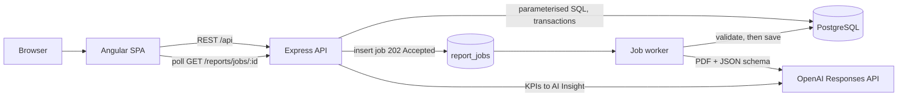

# Report Hub

[](https://github.com/ShaneeH/senus-board-reporting/actions/workflows/ci.yml)

**Upload a company's financial report PDF and get validated KPIs, trend charts, an AI-written board briefing and a one-click board-report PDF.**

**Live demo:** https://senus-frontend.vercel.app

<!--
  TODO (Shane): record a short demo and save it as docs/demo.gif (see docs/README.md),
  then remove this comment. The image below will render once the file exists.
-->


---

## Features

- **PDF to structured data:** upload an annual/interim report; the OpenAI Responses API extracts companies, periods and figures into a strict JSON schema.
- **Rejects non-financial documents:** the model classifies the document *and* deterministic server-side checks run before anything is written. A CV, invoice or brochure is refused with a clear message and nothing is stored.
- **Background processing:** uploads return `202 Accepted` with a job id; a worker analyses the PDF while the UI shows *Processing…* and a toast fires on success, rejection or failure.
- **KPI dashboard:** revenue, gross/operating profit, EBITDA, net profit, cash, debt, assets, liabilities, equity, operating cash flow, EPS, customers, with derived margins and ratios, period-over-period comparison and charts (revenue, margins over time, customers). Charts and cards only appear when there is data for them.
- **AI Insight:** a slide-out panel explaining performance, market/economic/social factors, improvement areas and risks, grounded only in the stored KPIs. Cached per period, can be regenerated and copied.
- **Board report PDF:** a branded PDF with the KPI table, changes vs the previous period, charts and the cached AI insight.
- **Data Enrichment:** upload another document for a company and period you already have (e.g. a FY2024 results announcement, then the FY2024 annual report) and Report Hub **enriches the existing period record** instead of creating a duplicate. New figures fill gaps, missing figures never erase stored ones, and changed figures are reported as `conflicts[]`. Every period keeps links to all of its source documents, and the dashboard shows *Sources: N documents* with an *Enriched* badge.
- **Duplicate detection:** SHA-256 of every uploaded PDF; the same file is never processed twice.
- **Demo mode:** `npm run db:seed:demo` loads *Northwind Analytics plc*, a **fictional** company, marked with a *Demo data* badge.

## Tech stack

| Layer | Tech |
| --- | --- |
| Frontend | Angular 21 (standalone components, RxJS), Chart.js, jsPDF, Vitest |
| Backend | Node.js 20, Express 5, TypeScript, Multer, express-rate-limit, `node:test` |
| AI | OpenAI Responses API + Files API, strict JSON-schema structured output |
| Database | PostgreSQL (`pg`), SQL migrations |
| CI / hosting | GitHub Actions, Vercel (frontend), Postgres on Neon or similar |

## Architecture



1. `POST /api/reports/add` checks the PDF (type, size, magic bytes), hashes it and refuses duplicates. It then queues a `report_jobs` row and returns `202` with a `jobId`.
2. The worker claims jobs with `FOR UPDATE SKIP LOCKED` and sends the PDF to OpenAI with a strict schema. It validates the result and saves it in one transaction. It also deletes the uploaded file from OpenAI, whatever the outcome.
3. The frontend polls `GET /api/reports/jobs/:id` and shows a toast when the job is `succeeded`, `rejected` or `failed`.

## Key engineering decisions

- **Deterministic KPI maths.** The AI only *extracts* reported figures. Margins, ratios and period-over-period changes are computed in TypeScript on the server, so they are reproducible and testable. The AI Insight prompt receives these numbers and is told not to recompute or invent figures.
- **AI output is untrusted input.** Structured output uses a strict JSON schema, and the result is validated again on the server: types, plausible values, period format, at least one core metric, and an explicit `isFinancialReport` classification. Anything that fails returns `422` before any DB write.
- **Data Enrichment by merge, not insert.** Companies are matched by name, case-insensitively, and periods by `(company, period)`. Each field is written as `COALESCE(new, existing)`, so incoming values update the record and nulls never overwrite. Before the update, any field where both values are non-null and differ is collected into `conflicts[]` and returned to the client. Many-to-many `document_periods` rows keep provenance, and derived metrics and cached AI insights are refreshed from the merged figures.
- **Idempotency and dedup.** A SHA-256 hash with a unique constraint stops the same PDF being processed twice. Re-running migrations and the demo seed is safe.
- **Transactions.** A company, its document, its periods and their links are written in one transaction, so a failure leaves nothing half-saved. Cached AI insights are invalidated when their figures change.
- **Rate limiting** on uploads and AI generation protects the OpenAI bill.
- **Typed errors.** OpenAI, database and validation failures map to specific HTTP statuses and readable messages (e.g. 429 rate limit, 504 timeout, 503 missing key). They are logged with a request id.
- **Migrations.** Numbered, idempotent SQL files (`backend/database/migrations`) applied under a Postgres advisory lock and recorded in `schema_migrations`.
- **Sync or async jobs.** `JOB_MODE=async` uses the in-process worker on long-running hosts. `JOB_MODE=sync` processes inside the request and is the default when `VERCEL` is set, because serverless functions are frozen after responding.

## Local setup (Linux)

Prerequisites: Node 20+, PostgreSQL 14+, an OpenAI API key.

```bash
git clone https://github.com/ShaneeH/senus-board-reporting.git
cd senus-board-reporting

# Database
sudo -u postgres createuser --pwprompt reporthub
sudo -u postgres createdb -O reporthub reporthub

# Backend
cd backend
cp .env.example .env
#   DATABASE_URL=postgres://reporthub:<password>@localhost:5432/reporthub
#   OPENAI_API_KEY=sk-...
#   OPENAI_MODEL=<a model that supports PDF input + structured output>
#   JOB_MODE=async   # optional; async is the default outside Vercel
npm ci
npm run db:migrate
npm run db:seed:demo      # optional: fictional Northwind Analytics plc data
npm run dev               # http://localhost:3000

# Frontend (new terminal)
cd ../frontend
npm ci
npx ng serve              # http://localhost:4200, uses the development environment -> localhost:3000
```

## Testing

```bash
cd backend && npm test                      # build + node:test (services, validators, routes, worker, OpenAI fakes)
cd frontend && npx ng test --watch=false    # Vitest unit tests for components and services
```

GitHub Actions runs both suites plus production builds on every push and pull request.

## Deployment notes

- **Frontend:** Vercel (`frontend/`, Angular preset). The production `apiUrl` is in `src/environments/environment.ts`.
- **Backend:** It works on Vercel with `JOB_MODE=sync`. Background jobs need a long-running host such as Render, Railway, Fly.io or a VM, with `JOB_MODE=async`. On serverless, the process is frozen once the response is sent, so the in-process worker would never run.
- **Database:** any Postgres (e.g. Neon). Run `npm run db:migrate` against it.

## Roadmap

- **Authentication** and per-user workspaces (write endpoints are open in the demo)
- **Review before save:** show extracted figures for confirmation or editing before they're committed
- **Source citations:** link each figure to the page/table it came from
- **Ask your report:** chat over a stored report, grounded in its figures
- **Anomaly alerts:** flag unusual swings between periods automatically

---

*Northwind Analytics plc is a fictional company. Its figures are made up for demonstration only.*
